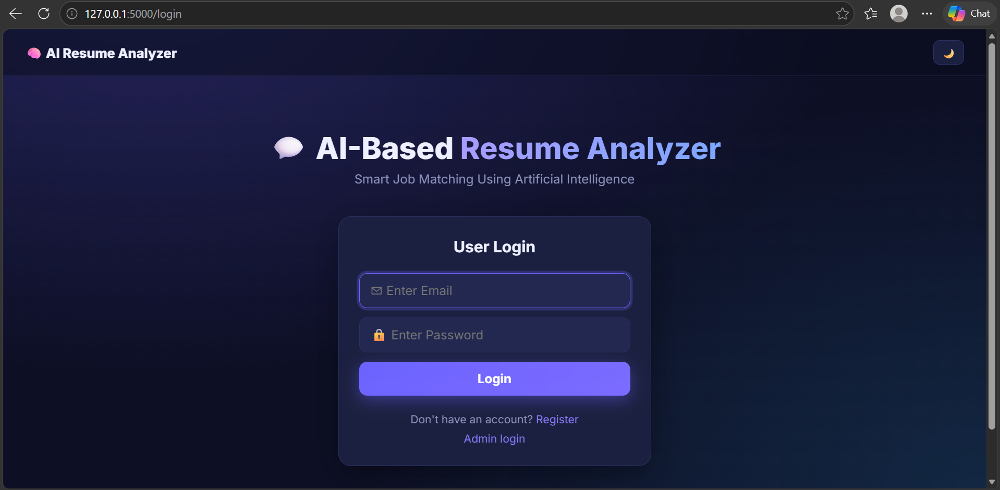
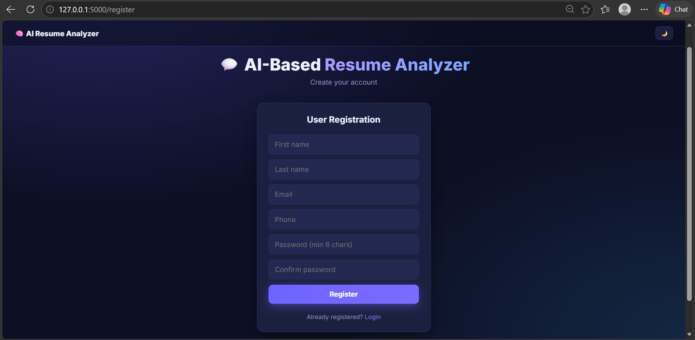
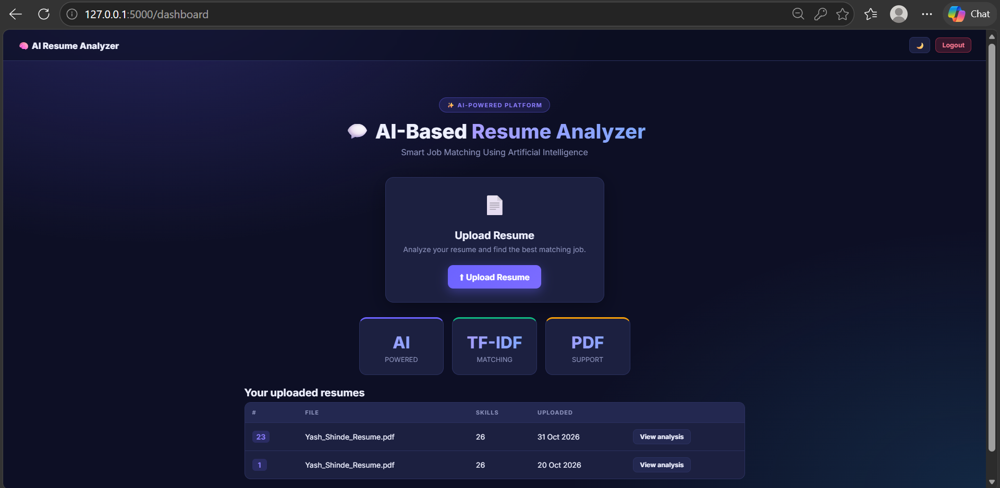
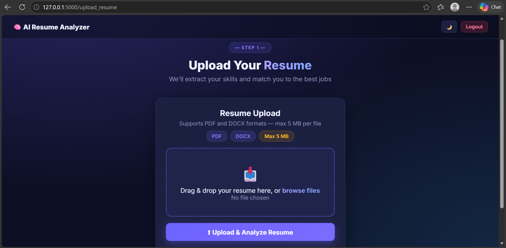
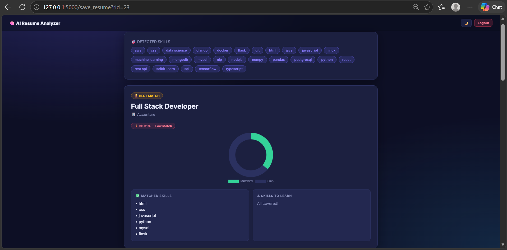
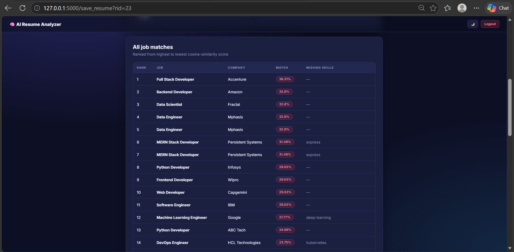
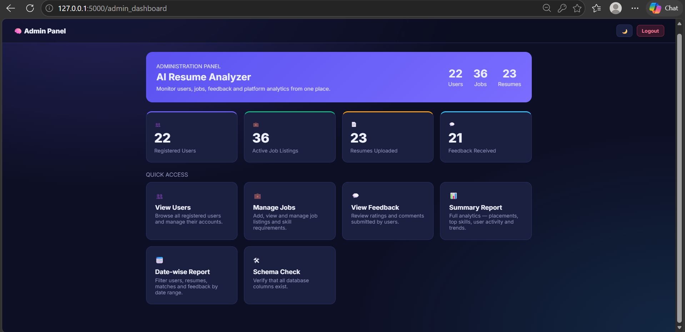
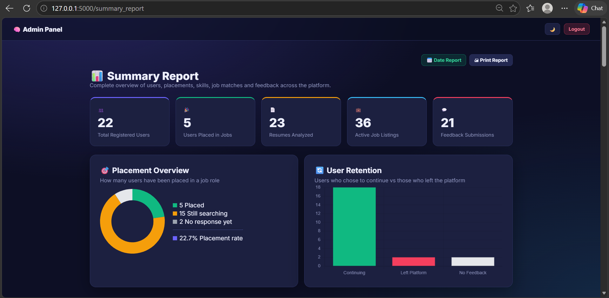

# 🤖 AI-Based Resume Analyser


> A full-stack resume analysis web app that extracts skills from uploaded resumes and matches them with job descriptions using **TF-IDF + Cosine Similarity**.

---

### 📌 Project Overview

**AI-Based Resume Analyser** is a Flask + MySQL application where users can register, upload resumes (PDF/DOCX), detect skills, and get job-match scores.  
Admins can manage users, jobs, feedback, and view analytical reports with charts.

---

### ✨ Features

**User Side**
- User registration and login (hashed passwords)
- Resume upload (PDF / DOCX)
- Automatic skill detection
- Job matching using TF-IDF + Cosine Similarity
- Match score display
- User dashboard and feedback

**Admin Side**
- Admin login and dashboard
- Manage users and jobs
- Skill detection and job match reports
- Summary and date-wise reports (Chart.js)
- Feedback management
- Auto database setup on first run

---

### 📸 Screenshots

#### User Login


#### User Register


#### User Dashboard


#### Upload Resume


#### Detected Skills


#### Job Matches


#### Admin Dashboard


#### Summery Report


---

### 🛠️ Tech Stack

| Layer | Technology |
| --- | --- |
| Backend | Python, Flask |
| Database | MySQL |
| Matching Logic | scikit-learn (TF-IDF, Cosine Similarity) |
| Resume Parsing | pdfplumber, python-docx |
| Frontend | HTML5, CSS3, JavaScript, Chart.js |

---

### 📂 Project Structure

```text
AI-Based-Resume-Analyser/
│
├── app.py
├── config.py
├── requirements.txt
├── database.sql
├── seed_data.sql
├── static/
│   ├── css/style.css
│   └── js/main.js
├── templates/
├── screenshots/
│   ├── user/
│   │   ├── login.png
│   │   ├── register.png
│   │   ├── dashboard.png
│   │   ├── upload_resume_file.png
│   │   ├── detected_skills.png
│   │   └── job_matches.png
│   └── admin/
│       └── dashboard.png
├── uploads/
└── README.md
```

---

### 🚀 How to Run

1. Install **Python 3.11+** and **MySQL 8**
2. Open `config.py` and set your MySQL password:
```python
DB_PASSWORD = "your_mysql_password"
```
3. Install and run:
pip install -r requirements.txt
python app.py
4. Open: http://127.0.0.1:5000
Database tables and sample jobs are created automatically on first start.

---

### 👨‍💻 Author
**Abhishek Jambhale**  
MCA Student | Aspiring Data Analyst & Data Scientist  
📍 Pune, Maharashtra  

- LinkedIn: [abhishek-jambhale](https://www.linkedin.com/in/abhishek-jambhale-4a3002442)  
- Email: abhishekjambhale.18@gmail.com  

---

⭐ Star this repository if you like the project!

